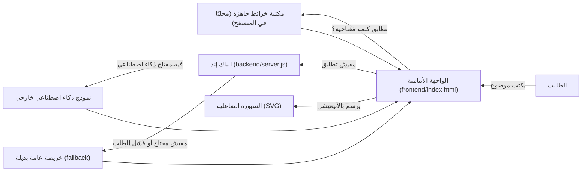

# اشرحلي (Eshrahli)

## الفكرة في جملة واحدة
تطبيق ويب تعليمي بيدي الطالب سبورة بيضاء ذكية: يكتب أي موضوع بيذاكره، والذكاء الاصطناعي يرسمه قدامه كخريطة ذهنية متحركة بالخط اليدوي، خطوة بخطوة، بدل ما يقرأ فقرة طويلة.

## الإلهام
الفكرة مستوحاة من ميزة **Knowie** في تطبيق [Knowunity](https://knowunity.com) — تطبيق EdTech ألماني بيستخدمه ملايين الطلاب في أوروبا وأمريكا اللاتينية. Knowie بيحول إجابة الذكاء الاصطناعي من نص عادي لخريطة مفاهيم (mind map) بترتسم بأنيميشن تدريجي على سبورة، زي لو حد بيشرحلك لايف.

## المشكلة اللي بنحلها
- المذاكرة من نص طويل متعب وبيتنسى بسرعة.
- الطالب محتاج يشوف العلاقة بين الأفكار (الموضوع الرئيسي → فروعه → تفاصيله) مش يقرأها كسطور متتالية.
- مفيش أداة عربية بسيطة بتعمل كده بشكل تفاعلي ومجاني.

## المستخدم المستهدف
طلاب المرحلة الإعدادية والثانوية (وأي حد بيذاكر موضوع جديد) اللي عايزين يفهموا بسرعة قبل الامتحان أو وهما بيراجعوا.

## المميزات الحالية (النسخة التجريبية الحالية)
- **سبورة تفاعلية (Frontend):** واجهة عربية RTL، بترسم خريطة ذهنية بأنيميشن حقيقي (خطوط بتترسم + مربعات بتتحدد + نصوص بتظهر) باستخدام SVG خالص من غير أي مكتبة خارجية.
- **مكتبة مواضيع جاهزة:** 4 مواضيع دراسية (المرايا في الفيزياء، الدورة الدموية، الثورة الفرنسية، التمثيل الضوئي) بترسم فورًا من غير ما تحتاج سيرفر.
- **باك إند (API):** سيرفر Node/Express فيه endpoint واحد (`POST /api/mindmap`) بياخد أي موضوع حر وبيرجع خريطة ذهنية كـ JSON.
  - لو فيه مفتاح `ANTHROPIC_API_KEY` متظبط، السيرفر بيطلب من نموذج ذكاء اصطناعي حقيقي يولّد الخريطة.
  - لو مفيش مفتاح، أو النموذج فشل لأي سبب، بيرجع خريطة عامة بديلة (fallback) بدل ما يكسر التجربة.
- **أسئلة متابعة:** بعد ما الخريطة الأساسية تترسم، الطالب يقدر يكتب سؤال متابع فيضاف كفرع جديد على نفس السبورة.
- **زوم وسكرول** على السبورة، وزرار "سبورة جديدة" لمسح كل حاجة والبدء من الأول.

## اللي مش موجود لسه (معروف ومقصود)
- مفيش قاعدة بيانات أو حسابات مستخدمين — كل حاجة بتتمسح لو عملت refresh.
- مفيش حفظ للسبورة أو مشاركتها مع حد تاني.
- التسجيل الصوتي وإرفاق الصور في شريط الكتابة شكلي بس دلوقتي (مش متوصل بحاجة فعلية).

## البنية التقنية (Architecture)



### الواجهة الأمامية (`frontend/`)
- ملف HTML/CSS/JS واحد خالص، من غير أي framework أو build step — تقدر تفتحه بالمتصفح مباشرة.
- الرسم كله SVG بترسمه السكريبت بنفسه (خطوط + مربعات + نصوص)، والأنيميشن عن طريق `requestAnimationFrame` و CSS transitions.
- فيه دعم كامل للوضع الداكن (السبورة البيضاء بتبقى سبورة طباشير سودة تلقائيًا).

### الباك إند (`backend/`)
- Node.js + Express.
- `POST /api/mindmap` — بياخد `{ "topic": "..." }` وبيرجع:
  ```json
  { "title": "...", "branches": [ { "label": "...", "highlight": false, "children": ["...", "..."] } ] }
  ```
- `GET /api/health` — فحص سريع إن السيرفر شغال.
- تكامل اختياري مع Anthropic API (قابل للتبديل لأي نموذج تاني بتعديل `routes/mindmap.js`).

## خطة التطوير المقترحة (Roadmap)
1. ربط حقيقي بنموذج ذكاء اصطناعي ثابت ومُجرَّب (مش fallback بس).
2. حفظ السبور في قاعدة بيانات (مثلاً SQLite أو Postgres) + نظام حسابات بسيط.
3. مشاركة رابط للسبورة مع زميل.
4. رفع صورة واجب (OCR) بدل ما تكتب الموضوع بإيدك.
5. تسجيل صوتي حقيقي بدل الزرار الشكلي.
6. تطبيق موبايل (React Native / Flutter) بنفس الفكرة.

## حالة المشروع
🚧 **نموذج أولي (Prototype / MVP)** — جاهز للتجربة والعرض، مش جاهز للإنتاج الفعلي.
